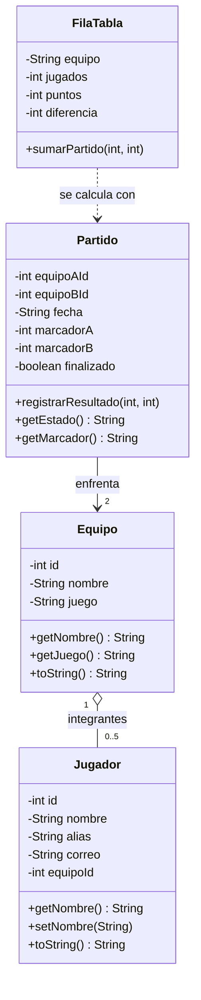

# Diseño

## Diagrama de clases

`-` = privado, `+` = público. Los atributos son privados (encapsulamiento) y `Partido` protege sus propias reglas con `throw`.

## Modelo de datos (SQLite · `arena.db`)

| Tabla | Columnas |
|---|---|
| `jugador` | `id` PK · `nombre` · `alias` · `correo` UNIQUE · `equipo_id` (0 = sin equipo) |
| `equipo` | `id` PK · `nombre` UNIQUE · `juego` |
| `partido` | `id` PK · `equipo_a` → equipo · `equipo_b` → equipo · `fecha` · `marcador_a` · `marcador_b` · `finalizado` (0 o 1) |

## Reglas del torneo

- Victoria = 3 puntos, empate = 1, derrota = 0.
- Orden de la tabla: más puntos arriba; si empatan, mejor diferencia.
- Máximo 5 integrantes por equipo (constante `MAXIMO` en `EquipoController`).
